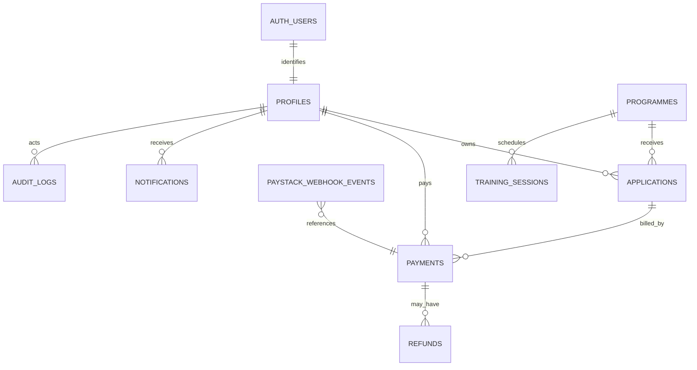

# Tamark Solar Energy — Production Readiness Tracker

> **Authoritative project tracker.** Before changing a feature, read its status, dependencies, acceptance criteria, and evidence here. After a change, update this document with what changed and the actual test output. `IMPLEMENTED` is not `TESTED`; `TESTED` is not `APPROVED FOR PRODUCTION`. Never claim production approval without passing the listed acceptance criteria and recording review evidence.

**Baseline reviewed:** 2026-11-06  
**Project root:** this document's directory  
**Current release stage:** Pre-production engineering; production approval is not established  
**Document history:** No prior `TAMARK_PRODUCTION_READINESS.md` was present during this baseline. This initial tracker records the current repository and prior validation evidence without replacing or deleting other project documentation.

## Dashboard

The inventory below contains 25 product modules. Module status is assigned from repository evidence, not inferred from a visible interface. Detailed acceptance evidence remains incomplete for every module; the small set of checks that has run is recorded separately in [Validation evidence](#validation-evidence).

| Status | Count |
|---|---:|
| Total tracked product modules | 25 |
| Not started | 4 |
| In progress | 2 |
| Implemented (acceptance not yet established) | 18 |
| Tested against full module acceptance criteria | 0 |
| Approved for production | 0 |
| Blocked | 1 |

**Critical outstanding issues:** a user-reported Supabase migration attempt failed because required enum labels/columns were unavailable; the current database state is unknown and must be inspected read-only before retrying. The migration chain is not validated. There is no concurrency/load-test evidence; cohort seat-capacity allocation is absent; private application-document handling is absent; backup restoration, production monitoring, and release gates have no recorded operational evidence.

## Table of contents

- [Project overview](#project-overview)
- [Brand assets and icons](#brand-assets-and-icons)
- [Architecture and baseline review](#architecture-and-baseline-review)
- [Status and evidence rules](#status-and-evidence-rules)
- [Product modules](#product-modules)
- [Database and data integrity](#database-and-data-integrity)
- [Authentication and security](#authentication-and-security)
- [Payment and financial integrity](#payment-and-financial-integrity)
- [Concurrency and scalability](#concurrency-and-scalability)
- [Performance, reliability, and caching](#performance-reliability-and-caching) 
- [Mobile responsiveness and accessibility](#mobile-responsiveness-and-accessibility)
- [Notifications and communications](#notifications-and-communications)
- [Analytics and reporting](#analytics-and-reporting)
- [Backups and disaster recovery](#backups-and-disaster-recovery)
- [Monitoring and system health](#monitoring-and-system-health)
- [DevOps and deployment](#devops-and-deployment)
- [Privacy and legal review](#privacy-and-legal-review)
- [Testing and quality assurance](#testing-and-quality-assurance)
- [Issue register and change management](#issue-register-and-change-management)
- [Production release gates](#production-release-gates)
- [End-to-end acceptance journey](#end-to-end-acceptance-journey)
- [Architecture decisions awaiting confirmation](#architecture-decisions-awaiting-confirmation)
- [Prioritized implementation plan](#prioritized-implementation-plan)
- [Validation evidence](#validation-evidence)

## Project overview

- **Purpose:** Tamark Solar Energy's public website and online solar-training application and student-management platform.
- **Business location:** Kaduna, Nigeria. Business contact details, programme prices, policies, and operational targets must come from Tamark; none are to be invented.
- **Target users:** Students and Administrators (`admin` is the highest account role).
- **Capabilities:** Public content and training catalogue, student registration/authentication, applications, Paystack payments, student and administrator dashboards, programme and application management, notifications, reports, and financial operations.
- **Stack found in the repository:** Next.js App Router, React, TypeScript, Supabase PostgreSQL/Auth/Storage, Paystack, and intended Vercel deployment. Dependency versions and commands are in `package.json`.
- **Design reference found:** `Tamark Solar Energy.html`, plus the existing application screens. Preserve the approved brand, green/emerald palette, solar-yellow accents, typography, and desktop composition while designing mobile interactions for mobile.
- **Architecture objective:** A maintainable modular monolith with PostgreSQL transactions and managed services. Do not introduce queues, cache vendors, microservices, or other infrastructure without a measured need and a documented decision.

## Brand assets and icons

- **Approved source supplied:** `public/Solar Leaf Energy Emblem.png` (1254×1254 RGB PNG). The source is kept unchanged.
- **Optimized site mark:** `public/solar-leaf-energy-emblem.png`, cropped around the artwork and resized from the supplied source. The reusable `src/components/brand-mark.tsx` is used in the public header/footer, student/admin sidebar, and application wizard. The payment receipt embeds the same optimized mark.
- **Rounded icons:** favicon, Apple icon, and all PWA icons have rounded transparent corners; standard 192/512 icons and a maskable 512 icon are listed in `public/site.webmanifest`.
- **Notification icon:** browser push uses the 192px emblem asset instead of the previous stock photo.
- **Acceptance:** source remains intact; optimized marks/icons are derived from it; favicon/Apple/manifest metadata is present; manifest paths resolve; public header renders the image. Test evidence is logged under [Validation evidence](#validation-evidence). Student/admin visual checks remain outstanding.
- **Install prompt:** `[x] IMPLEMENTED` — `src/components/install-prompt-banner.tsx` captures supported browser install events, offers iOS/iPadOS manual Add to Home Screen steps, registers the app service worker, and supports dismissal/installed state. Real OS installation and cross-platform behavior still require device verification.

## Architecture and baseline review

### Existing architecture

The Next.js application serves public and authenticated student/admin routes. Server API routes use Supabase clients; user-scoped operations are intended to rely on Supabase Auth and RLS, while privileged workflows use a server-only service-role client. Paystack is called server-side for checkout, verification, refunds, and reconciliation. The `supabase/` directory contains the initial schema and follow-on SQL migrations.

The diagram represents entities found or introduced by current SQL, not a fully approved target model. Cohorts, reservations, enrollments, documents, notification delivery jobs/preferences, support requests, and reconciliation run records are not all represented as implemented database entities.

### Findings from the initial review

1. **Database workflow foundation exists, but is unverified.** Security migrations add payment status transitions, audit/rate-limit/webhook/refund tables, RLS policies, and application/payment workflow functions. A user reports errors while running security migrations 01–03, including a reference to an unsupported higher admin role, a missing `successful` payment enum value, and missing `application_reference`. Current application code grants all active admins financial access; migration 05 removes the obsolete permission flag/role from a legacy database after its state is verified. The actual database state is still unknown and must be inspected read-only before retrying. SQL validity, policy behavior, and grants remain unproven.
2. **Payment and submission protection is partial.** Payment initialization reserves a local record and the migration adds a single-active-payment index. Verification checks provider reference, amount, currency, and customer email. Final application submission is a separate authenticated action. There is no automated integration or concurrency test evidence for the full flow.
3. **Webhook claiming is implemented in migration/source but untested against PostgreSQL.** The event-claim function uses row locking and a bounded stale-claim window; duplicate event and timeout/retry behavior need staging tests.
4. **Application save serialization is not stale-write protection.** The draft-save function locks a student's profile, which serializes that student's saves, but there is no version/expected-`updated_at` check. A delayed older autosave can still overwrite newer content.
5. **Application submission retries are safe against duplicate references but not fully idempotent in response.** A repeated request after successful submission is rejected as not a draft instead of returning the existing application reference.
6. **Administrator decisions use a conditional status update, but do not expose a record version to detect stale review screens.** Conflicting terminal decisions appear to be gated by the status predicate; verify with concurrent integration tests and add an explicit stale-version contract before calling this complete.
7. **Cohort capacity and seat reservation are not implemented.** The schema includes training sessions, not cohort capacity, holds, expiry, or enrollment allocation.
8. **Operational evidence is missing.** No staging database execution, load test, backup restore, CI workflow, production monitoring setup, or production smoke test is recorded. The current workspace is not a Git repository.
9. **Some requirements are deliberately incomplete.** Private application documents, signed downloads, partial refunds, automated refund reconciliation, email delivery jobs, comprehensive audit coverage, and a system-health dashboard are not implemented.
10. **Decisions that affect architecture remain open.** Cohort seat business rules, target load/SLOs, backup RPO/RTO and retention, email/SMS providers, personal-data retention, and legal notices require business/provider decisions.

This review identifies a staged approach: first establish migration and workflow integration tests; then close optimistic-concurrency and idempotency gaps; then define cohort behavior before adding capacity data structures; then measure performance and implement operations based on confirmed targets. No production architecture or provider switch is approved by this review.

## Status and evidence rules

Use one status per tracked item:

| Marker | Meaning |
|---|---|
| `[ ] NOT STARTED` | No verified implementation exists. |
| `[~] IN PROGRESS` | Partially implemented or actively being changed. |
| `[x] IMPLEMENTED` | Code exists; acceptance tests have not all passed. |
| `[T] TESTED` | All listed acceptance criteria for this item passed and evidence is recorded. |
| `[A] APPROVED FOR PRODUCTION` | Acceptance, security, operational, and company approval requirements passed with recorded approver/evidence. |
| `[!] BLOCKED` | Cannot proceed until the named dependency/decision is resolved. |

For every material status change, record: date, status, commit/PR or file references when available, commands or test scenario, observed result, reviewer/approver, and unresolved limitations. Do not count implementation as test evidence. Do not mark unknown work complete. If the repository lacks Git history, record that fact rather than fabricating a commit.

## Product modules

For every module below, frontend, backend, database, security, and testing criteria are explicit. Each row has an evidence field; update it only with actual results. “Owner” defaults to **Unassigned** until Tamark assigns a responsible person.

| # | Module and objective | Current status | Acceptance criteria, dependencies, and evidence |
|---:|---|---|---|
| 1 | **Public website** — present approved company information and route users to services/training. | `[x] IMPLEMENTED` | **UI:** approved design and mobile behavior. **API/data:** public content only; no private data. **DB:** public content must have safe publication rules. **Security:** no secret/private data in HTML or cache. **Test:** all public routes, mobile, links, and content approval. **Depends:** company-approved copy/contact. **Evidence:** `src/app/page.tsx`, `src/components/home-page.tsx`, shared `src/components/brand-mark.tsx`; logo appears in public header/footer. Build and mobile-homepage visual screenshot pass; other public routes and full mobile criteria remain open. **Owner:** Unassigned. |
| 2 | **Homepage** — communicate Tamark's identity and primary actions. | `[x] IMPLEMENTED` | **UI:** retain prototype composition/branding and responsive hero. **Backend/DB:** approved content and images only. **Security:** safe image/content handling. **Test:** 320–1440px, keyboard, contrast, Core Web Vitals. **Depends:** approved copy/assets. **Evidence:** `src/components/home-page.tsx`; new Solar Leaf source/derived logo is rendered in shared site header. Favicon/app icon assets and manifest added; no Lighthouse evidence. **Owner:** Unassigned. |
| 3 | **About page** — publish approved company story and profile. | `[ ] NOT STARTED` | **UI:** accessible branded page. **API/DB:** CMS or approved static source decision. **Security:** constrain publishing permissions. **Test:** content review, responsive/accessibility. **Depends:** Tamark-approved company content. **Evidence:** no dedicated route verified in `src/app/`. **Owner:** Unassigned. |
| 4 | **Services** — explain approved solar services and enquiry path. | `[ ] NOT STARTED` | **UI:** approved service content and contact action. **API/DB:** decide static content vs managed services catalog. **Security:** validate enquiry data and rate-limit submissions if added. **Test:** content, links, mobile, abuse/rate-limit. **Depends:** service scope and contact workflow confirmation. **Evidence:** no dedicated services route/module verified. **Owner:** Unassigned. |
| 5 | **Training catalogue** — list published programmes. | `[x] IMPLEMENTED` | **UI:** cards and mobile layout. **API/DB:** only published/approved details, paginated if growth requires. **Security:** public read must not expose drafts/private fields. **Test:** publication, empty/loading/error, query plan, responsive. **Depends:** approved programme data. **Evidence:** `src/app/training/page.tsx`, `src/components/programme-catalog.tsx`; course content/prices remain business-controlled. **Owner:** Unassigned. |
| 6 | **Programme details** — provide approved content and application entry. | `[x] IMPLEMENTED` | **UI:** accessible detail page. **API/DB:** valid slug/programme data and current approved price. **Security:** do not trust browser prices. **Test:** unpublished/invalid slug, price changes, cache invalidation. **Depends:** catalogue. **Evidence:** `src/app/training/[slug]/page.tsx`; no cache invalidation acceptance evidence. **Owner:** Unassigned. |
| 7 | **Student registration** — create student accounts. | `[x] IMPLEMENTED` | **UI:** validate and explain confirmation. **API/DB:** profile creation idempotent. **Security:** Supabase Auth, server validation, abuse controls. **Test:** simultaneous registration, duplicate email, confirmation and failure recovery. **Depends:** Auth/SMTP dashboard settings. **Evidence:** `src/components/auth-form.tsx`; no concurrent test. **Owner:** Unassigned. |
| 8 | **Authentication and password recovery** — sign in, sign out, reset/update password. | `[x] IMPLEMENTED` | **UI:** clear errors and recovery. **API/DB:** valid Supabase session lifecycle. **Security:** email confirmation, policy, redirect allowlist, Auth rate limits, privileged MFA decisions. **Test:** expired/invalid recovery, suspended account, redirect validation. **Depends:** Supabase Auth configuration. **Evidence:** `src/app/sign-in/`, `src/app/sign-up/`, `src/app/reset-password/`, `src/middleware.ts`; provider settings unverified. **Owner:** Unassigned. |
| 9 | **Student application process** — save drafts and submit only after successful payment. | `[~] IN PROGRESS` | **UI:** preserve drafts and separate payment from final submission. **API/DB:** atomic owner-checked save/submit; idempotent retry; version check. **Security:** RLS and RPC authorization. **Test:** simultaneous saves/submits, stale autosave conflict, no unpaid submission. **Depends:** programmes, payments, migrations 02–04. **Evidence:** `src/components/application-wizard.tsx`, `src/app/api/applications/`, `supabase/security_financial_03_concurrency.sql`, and new `supabase/security_financial_04_draft_concurrency.sql`; implementation returns HTTP 409 with the current draft and requires explicit load-latest before payment can continue. Source-contract tests pass; database/RLS/concurrency acceptance remains open. **Owner:** Unassigned. |
| 10 | **Paystack payment integration** — initialize checkout using server-approved amount. | `[x] IMPLEMENTED` | **UI:** retry without losing application. **API/DB:** reserve unique reference before provider call; bounded timeout; safe ambiguous retry. **Security:** secrets server-only; never trust callback as proof. **Test:** concurrent initialize, provider timeout/rejection, duplicate reference, currency/amount checks. **Depends:** financial migrations and test account. **Evidence:** `src/app/api/payments/initialize/route.ts`; provider integration not exercised here. **Owner:** Unassigned. |
| 11 | **Payment verification/webhook** — verify and record provider outcomes once. | `[x] IMPLEMENTED` | **UI:** no false success; retry state clear. **API/DB:** verify provider data; idempotent transition/event claim. **Security:** exact raw-body HMAC; bounded payload; ownership and rate limit. **Test:** valid/invalid signature, duplicate/concurrent delivery, retry after crash, mismatched data. **Depends:** webhook migration and Paystack config. **Evidence:** `src/app/api/payments/verify/route.ts`, `src/app/api/payments/webhook/route.ts`, `src/lib/paystack.ts`, `tests/security/paystack-signature.test.mjs` (4 unit tests pass; DB/provider behavior untested). **Owner:** Unassigned. |
| 12 | **Student dashboard** — show own applications, payments, notifications, and profile. | `[x] IMPLEMENTED` | **UI:** responsive, understandable status/empty/error states. **API/DB:** owner-scoped data and pagination. **Security:** RLS; no cross-user cache. **Test:** two-student isolation, suspended user, mobile and keyboard. **Depends:** Auth and RLS migrations. **Evidence:** `src/app/student/`, `src/components/dashboard-manager.tsx`, `src/app/api/student/`; RLS integration tests absent. **Owner:** Unassigned. |
| 13 | **Administrator dashboard** — review operational records and actions. | `[x] IMPLEMENTED` | **UI:** accessible tables/actions. **API/DB:** role-checked queries and pagination. **Security:** server-side admin checks; admin is the highest role and grants finance access. **Test:** student, active admin, and suspended admin. **Depends:** RBAC migration. **Evidence:** `src/app/admin/`, `src/lib/api-auth.ts`; all admin APIs use the same active-admin authorization; role matrix not integration-tested. **Owner:** Unassigned. |
| 14 | **Application management** — review and decide application outcomes. | `[~] IN PROGRESS` | **UI:** show fresh status and stale/conflict warning. **API/DB:** explicit transitions and optimistic version/status predicate. **Security:** audit actor and decision. **Test:** two administrators make conflicting decisions concurrently; exactly one valid terminal transition. **Depends:** application version/transition design. **Evidence:** `src/app/api/admin/[...path]/route.ts`, `src/components/dashboard-manager.tsx`; expected `updated_at` is now required and conditionally updated; no live concurrency test. **Owner:** Unassigned. |
| 15 | **Student management** — authorized administrators view/manage student records. | `[x] IMPLEMENTED` | **UI:** privacy-conscious listing and pagination. **API/DB:** minimize fields, avoid N+1, audit changes. **Security:** least privilege and export controls. **Test:** role matrix, pagination, data minimization, access audit. **Depends:** RBAC and privacy policy. **Evidence:** `src/app/api/admin/[...path]/route.ts`; acceptance tests absent. **Owner:** Unassigned. |
| 16 | **Training programme management** — maintain programme content, publication, and approved prices. | `[x] IMPLEMENTED` | **UI:** safe edit and confirmation for financial/publication changes. **API/DB:** validate and detect stale updates; indexes and cache invalidation. **Security:** admin authorization; audit. **Test:** concurrent edits, price approval, unpublished visibility, revalidation. **Depends:** content/price approval process. **Evidence:** `src/app/api/admin/[...path]/route.ts`, `src/components/dashboard-manager.tsx`; concurrency/cache tests absent. **Owner:** Unassigned. |
| 17 | **Training cohorts and capacity** — allocate seats without overselling. | `[ ] NOT STARTED` | **UI:** cohort dates, capacity, availability, deadlines, status. **API/DB:** transactional reservations, unique student/cohort constraint, expiry/release, confirmed enrollment. **Security:** only authorized cohort management; validate date/capacity. **Test:** 100 simultaneous attempts against 30 seats yields at most 30 confirmed/reserved; retries/expiry do not double-book. **Depends:** company rules for reservation point, hold duration, payment timing, waitlist, and cancellation. **Evidence:** no cohort-capacity table/function verified; current schedules are not seat inventory. **Owner:** Unassigned. |
| 18 | **Payment management** — inspect payment records and financial summaries. | `[x] IMPLEMENTED` | **UI:** admin-only data and clear gross/refund/net definitions. **API/DB:** authoritative successful records, pagination, no unbounded scans. **Security:** active-admin authorization at route and RLS layers. **Test:** role isolation and reconciliation fixtures. **Depends:** migrations, accounting definitions. **Evidence:** `src/app/api/admin/[...path]/route.ts`, `src/app/api/admin/finance/reconciliation/route.ts`; RLS untested. **Owner:** Unassigned. |
| 19 | **Refund management** — request and track eligible refunds. | `[x] IMPLEMENTED` | **UI:** clear confirmation, full amount, reason, pending/failed state. **API/DB:** idempotent single refund; atomic financial state; unknown outcome remains pending. **Security:** active-admin authorization, audit, rate limit. **Test:** concurrent refund requests and accepted/rejected/timeout provider responses. **Depends:** Paystack test and refund-state policy. **Evidence:** `src/app/api/admin/finance/refunds/route.ts`; provider/database tests absent; only full refunds exist. **Owner:** Unassigned. |
| 20 | **Notifications** — in-app and optional browser push. | `[x] IMPLEMENTED` | **UI:** read/unread and accessible links. **API/DB:** idempotent notification and delivery state. **Security:** own-user visibility; secrets private. **Test:** duplicate event, delivery failure, retry, preferences, notification failure never reverses payment. **Depends:** email/job-provider selection for transactional email. **Evidence:** `src/components/push-notification-control.tsx`, `src/app/api/student/push-subscriptions/route.ts`, `supabase/push_notifications_migration.sql`; durable email queue not implemented. **Owner:** Unassigned. |
| 21 | **Reports and analytics** — provide accurate, permission-filtered business/financial views. | `[x] IMPLEMENTED` | **UI:** metric definitions, filters, clear gross/refund/net. **API/DB:** aggregate actual records, avoid duplicates, pagination. **Security:** active-admin authorization, least-privilege export, privacy-safe CSV. **Test:** fixture reconciliation, export injection/privacy, financial totals. **Depends:** business metric definitions. **Evidence:** `src/app/api/admin/[...path]/route.ts`; CSV/current payment summaries exist; requested reports/filters/formats incomplete. **Owner:** Unassigned. |
| 22 | **Profile management** — allow safe student profile updates. | `[x] IMPLEMENTED` | **UI:** accessible validation and saved/error states. **API/DB:** field-level write grants and timestamps. **Security:** prevent role/suspension/permission escalation. **Test:** profile ownership and attempts to change restricted fields. **Depends:** Auth/RLS. **Evidence:** `supabase/schema.sql`, `src/app/api/student/`; policy integration test absent. **Owner:** Unassigned. |
| 23 | **Document management** — securely upload and retrieve application documents. | `[!] BLOCKED` | **UI:** file type/size guidance and upload recovery. **API/DB:** private bucket, metadata/ownership, signed short-lived downloads, retention/delete process. **Security:** content validation, malware strategy, no public URLs, audit. **Test:** cross-user access, malicious/oversized files, signed URL expiry. **Depends:** Tamark's document list, retention policy, storage/security choices. **Evidence:** no private application-document or signed-download workflow verified; see `SECURITY-ARCHITECTURE.md`. **Owner:** Unassigned. |
| 24 | **System settings** — maintain approved public contact and organizational settings. | `[x] IMPLEMENTED` | **UI:** role-appropriate settings and confirmation. **API/DB:** validation, audit, concurrency check, cache invalidation. **Security:** admin-only writes and controlled public fields. **Test:** unauthorized update, malformed values, cache propagation. **Depends:** approved contact data and permissions. **Evidence:** `src/app/api/admin/[...path]/route.ts`; acceptance/security tests absent. **Owner:** Unassigned. |
| 25 | **Support and contact management** — route and track student enquiries. | `[ ] NOT STARTED` | **UI:** accessible contact and case status. **API/DB:** validated, rate-limited support requests and retention. **Security:** protect personal data and prevent spam. **Test:** delivery, abuse limits, staff permissions, privacy. **Depends:** support owner, contact channel, response policy. **Evidence:** no support-request module verified; settings/contact presentation is not case management. **Owner:** Unassigned. |

## Database and data integrity

### Current model and required additions

Current SQL includes profiles, programmes, applications, payments, notifications, training sessions, announcements, organization settings, push subscriptions, and the financial/security tables introduced by the staged migrations. Validate this against actual deployed schema before further migrations.

Add or formalize only after requirements are approved: cohorts, reservations, confirmed enrollments, attendance, application documents, notification preferences/delivery jobs, payment reconciliation runs, and support requests. Avoid duplicate user tables; use Supabase Auth as identity and profiles for application-specific fields.

### Database checklist

- [x] Initial schema and versioned SQL migrations exist in `supabase/`.
- [~] Core primary keys, foreign keys, checks, and indexes exist; audit coverage and query plans are incomplete.
- [~] RLS is present and security migrations introduce stricter policies; role/ownership policies need staging tests.
- [~] Add version/expected-`updated_at` conflict protection: administrator decisions now compare the loaded version; application drafts and programme edits remain open, and the admin path needs database concurrency testing.
- [ ] Define data retention, archival, deletion, and financial-record correction procedures with Tamark/legal review.
- [ ] Review indexes with representative query plans and data volume; record slow-query baseline.
- [ ] Test migrations forward on a disposable/staging database and verify backups/rollback procedure.
- [!] Inspect the user-reported failed SQL execution before retrying; do not assume transaction rollback or run later migration files until prerequisites are confirmed.

### Migration approval checklist

- [ ] Confirm migration is additive or document data transformation/lock impact.
- [ ] Validate existing data against all new constraints before rollout.
- [ ] Apply to disposable environment; test RLS, grants, functions, and rollback/forward recovery.
- [ ] Capture query plans and execution time for material DDL/backfills.
- [ ] Take/verify pre-deployment backup and agree rollback/repair steps.
- [ ] Obtain database owner and release approver sign-off.
- [ ] Apply to production only through an approved, recorded deployment process.

### Current migration sequence

After the existing schema, dashboard, programme catalogue, and push-notification SQL listed in `README.md`, apply the security workflow migrations one at a time:

1. `supabase/security_financial_00_enum_values.sql` (commit this enum-only step before using the new labels).
2. `supabase/security_financial_01_primitives.sql`.
3. `supabase/security_financial_02_workflows.sql`.
4. `supabase/security_financial_03_concurrency.sql`.
5. `supabase/security_financial_04_draft_concurrency.sql` (only after 00–03 succeed; adds optimistic concurrency for draft saves).
6. `supabase/security_financial_05_admin_access.sql` (only after 00–04 succeed; grants active admins financial access and removes legacy role/finance flags).

The user reported executing migration files 01–03 and receiving prerequisite errors. No successful migration completion is evidenced; the resulting database state is unknown. Use the read-only diagnostics in `SECURITY-ARCHITECTURE.md` before retrying. Migrations 04 and 05 have been added locally but have not been applied. Staging validation remains a P0 release gate.

## Authentication and security

- [x] Supabase Auth sign-up/sign-in and password-reset UI exist.
- [~] Server-side authentication, role checks, suspension checks, same-origin mutation checks, security headers, API validation, and rate-limit/audit helpers exist.
- [~] All active admins can access financial routes; migration 05 and security migration RLS remain pending integration verification.
- [ ] Configure and evidence Supabase password policy, email verification, SMTP, redirect allowlist, Auth rate limits, session lifetime/refresh, MFA for privileged accounts, and recovery procedures.
- [ ] Add rate limits for registration, password reset, uploads, support, and sensitive admin operations where risk warrants; confirm retries remain usable.
- [ ] Add upload security only with private document flow; no public sensitive-document storage.
- [ ] Add dependency vulnerability scanning and documented patch response.
- [ ] Complete OWASP-oriented security and RLS testing; frontend route hiding is never a substitute for server authorization and database RLS.

## Payment and financial integrity

### Invariants

1. The server selects the approved programme amount and currency; clients cannot choose a charge amount.
2. A browser redirect never establishes payment success.
3. Successful payments require provider verification matching reference, amount, currency, and customer email.
4. Provider outcomes and internal state changes are recorded with unique references and atomic status transitions.
5. Payment verification does not imply admission approval and does not automatically submit the application.
6. The student explicitly submits only after successful payment; retries cannot create a second application reference.
7. Refund amounts and state remain linked to the original payment; unknown provider outcomes stay pending for reconciliation.
8. Financial reporting distinguishes gross successful payments, processed refunds, and net collections; do not infer revenue from pending/failed records.

### Test matrix

| Scenario | Expected result | Evidence |
|---|---|---|
| Successful payment | One successful internal record; application eligible for explicit submit | Not run against staging |
| Failed/abandoned payment | No successful state or receipt; safe retry path | Not run against staging |
| Invalid signature/body | Reject; do not mutate financial state | Signature unit tests pass; route/db integration not run |
| Duplicate/concurrent webhook | One financial effect; retry receives safe outcome | Not run against PostgreSQL |
| Amount/currency/email/reference mismatch | Do not finalize; audit/reconcile mismatch | Not run against provider |
| Two simultaneous checkout requests | At most one active internal payment for application | No concurrency test |
| Submit repeated concurrently/after success | One submission/reference; retry returns existing result | Implemented in migration 03; database concurrency test pending |
| Refund duplicate/timeout/rejection | Never issue duplicate refund silently; unknown outcome remains pending | Not run against Paystack |
| Receipt access | Only owner and successful payment can download | Not run against staging |

Current limitations and deployment prerequisites are expanded in `SECURITY-ARCHITECTURE.md`.

## Concurrency and scalability

### Critical acceptance criteria

- **Applications:** 100 concurrent draft saves for distinct students persist without cross-user writes; same-student stale writes return a conflict rather than silently overwrite; duplicate submit requests create exactly one reference and return the same result.
- **Payments:** 100 concurrent payment initializations for distinct applications do not collide; two requests for the same application create at most one active charge; verification/webhook races create exactly one successful state transition and one financial effect.
- **Cohorts:** for capacity 30, 100 simultaneous valid registration requests produce at most 30 active reservations/confirmed seats; duplicate student attempts consume one seat; expiry frees seats once.
- **Administrator reviews:** two stale decisions cannot silently overwrite one another; the losing request receives a conflict with current state/version.
- **Programme edits:** stale content/price updates are rejected or explicitly merged; price approval is separately authorized and audited.
- **Failure safety:** bounded retries only for safe/idempotent operations; never retry a provider-side charge/refund blindly after an ambiguous timeout.

### Design/testing plan

1. **Implemented:** make final application submission idempotent by returning the existing reference on repeated owner-authorized requests; migration 03 also backfills references for prior non-draft applications.
2. **Implemented, integration test pending:** administrator decisions now require the loaded `updated_at` and return HTTP 409 when the row has changed.
3. Add Postgres integration tests for unique constraints, RLS, RPCs, and transaction transitions on a disposable Supabase/Postgres environment.
4. **Implemented locally, tests pending:** add optimistic version checks to application drafts; programme edits still need the same protection and database integration tests are pending.
5. Design cohort capacity as a transactional reservation/confirmation flow only after business rules below are confirmed; include unique enrollment and bounded reservation expiry.
6. Run deterministic concurrency tests against the database (barrier-started transactions) before k6 traffic tests.
7. Exercise deadlock/serialization handling with bounded, jittered retries only for idempotent database operations; log exhausted retries without sensitive data.
8. Record request throughput, p50/p95/p99 latency, error rate, DB CPU/connections, slow queries, and provider processing latency. Do not claim user capacity until measured.

## Performance, reliability, and caching

- **Performance status:** unmeasured; no Lighthouse/Core Web Vitals, API percentile, or database query-plan baseline is recorded.
- **Targets:** pending baseline and Tamark approval. Set page/API budgets, availability, and error-rate targets only after representative staging measurements; do not invent SLAs.
- [ ] Measure Core Web Vitals and Lighthouse for public routes and authenticated dashboards on mobile and desktop.
- [ ] Profile bundle size, image delivery, database query plans, pagination, N+1 behavior, connection pool behavior, and slow queries.
- [ ] Cache only public published programme/company content; invalidate after changes. Never cache cross-user data, permissions, documents, or authoritative payment status.
- [ ] Establish safe request timeouts and bounded retries; preserve drafts when Paystack/network is unavailable.
- [ ] Choose background jobs only for reliable async work (email, reminders, exports, cleanup) after selecting a managed mechanism. Jobs require idempotency, retry/backoff, maximum attempts, failed-job review, and monitoring. Notification failure must not undo payment/submission.
- [ ] Add health checks and controlled error boundaries; avoid logging secrets or unnecessary personal/payment data.
- [ ] Load-test specified scenarios at 100 browsing/registration/draft/payment users and 50 administrators only after safe staging fixtures and provider-safe test mode are available.

## Mobile responsiveness and accessibility

The mobile drawer and mobile layout adjustments have been implemented previously, with viewport overflow and drawer interaction checks recorded in prior session history. That does not constitute a complete responsive/accessibility approval.

- [ ] Test 320, 360, 375, 390, 414, 480, 768, 1024, 1280, and 1440px.
- [ ] Cover homepage hero, services, training catalogue/details, application, checkout, student/admin dashboards, tables, charts, dialogs, and footer.
- [ ] Verify keyboard-only navigation, focus visibility/order/return, Escape behavior, semantic labels, screen-reader announcements, error associations, and 200% zoom.
- [ ] Audit contrast, non-color status cues, mobile touch targets, responsive text, and loading/error/empty states against WCAG 2.2 AA.
- [ ] Record tool/manual results and remediation evidence; do not claim WCAG conformance without an accessibility review.

## Notifications and communications

- Current in-app notifications and optional browser push exist. The transactional email/job system, delivery state/retries, preference center, and SMS integration are not verified as implemented.
- [ ] Confirm transactional email provider, domain authentication, templates, sender ownership, and Supabase Auth SMTP configuration.
- [ ] Define required event types and service-vs-marketing preferences; keep marketing consent separate.
- [ ] Persist delivery jobs/status and deduplication keys; implement bounded retry/backoff and a failed-delivery review path.
- [ ] Test that email/push failure cannot reverse payment or application transitions.
- [ ] Treat SMS as optional; do not configure a provider or imply SMS delivery until approved.
- **Owner:** Unassigned. **Company/provider decisions:** pending. **Evidence:** in-app/push code exists; no reliable email-queue delivery test.

## Analytics and reporting

Report definitions must be approved and derived from actual records. Initial definitions:

| Metric | Proposed calculation | Approval/evidence |
|---|---|---|
| Registered students | Count of non-deleted profiles with student role | Confirm account lifecycle |
| Applications by status | Count by canonical application status and selected period field | Define created vs submitted date |
| Successful payments | Count of payment rows with successful status | Staging fixture needed |
| Gross successful collections | Sum successful payment amounts, with currency grouping | Finance review required |
| Processed refunds | Sum processed refund amounts, by currency | Refund-provider reconciliation pending |
| Net collections | Gross successful collections minus processed refunds, by currency | Finance/accounting approval required |
| Pending payment issues | Count initiated/pending older than an approved threshold | Threshold pending |
| Cohort capacity/enrollment | Reserved and confirmed seats by cohort | Cohort model/business rules absent |

- [ ] Add date/programme/cohort/status filters and stable pagination.
- [ ] Add revenue by programme/cohort only when relationships and allocation rules are authoritative.
- [ ] Secure CSV/Excel/PDF exports and mitigate spreadsheet formula injection; limit personal data in exports.
- [ ] Validate totals against known staging fixtures and a finance-approved reconciliation sample.
- **Current:** basic CSV and successful-payment summary exist. Revenue/refund/net, cohort, filter, and export-format acceptance is incomplete.

## Backups and disaster recovery

- **RPO:** pending company/provider decision.
- **RTO:** pending company/provider decision.
- **Retention:** pending legal/finance approval; do not invent retention periods.
- [ ] Confirm Supabase backup/PITR plan, retention, access control, and production project tier.
- [ ] Document recovery from database loss, accidental deletion, failed migration, compromised access, storage failure, and bad deployment.
- [ ] Restore a backup into an isolated environment; verify profiles, applications, payments/refunds, relationships, constraints, storage objects, and Auth configuration.
- [ ] Record restoration date, duration, data loss window, integrity checks, operator, and remediation. A backup is not approved until a restore succeeds.
- [ ] Define and exercise incident escalation and financial reconciliation after recovery.
- **Current:** no backup configuration or restoration evidence in repository.

## Monitoring and system health

- [ ] Add privacy-safe structured logs with correlation/request IDs and redaction.
- [ ] Monitor API latency/errors, database health/connections/slow queries, Auth failures, payment initialization/verification, duplicate webhooks, refunds, notification delivery, storage, and traffic spikes.
- [ ] Configure alert ownership, severity, thresholds, delivery channel, and runbooks.
- [ ] Create an admin-only health view only for indicators that can be safely exposed; do not show secrets or internal infrastructure detail to students.
- [ ] Test alerts with controlled staging faults and record acknowledgement/escalation.
- **Current:** audit logs exist in migrations and some routes; no production telemetry/alert configuration or health dashboard evidence.

## DevOps and deployment

- [ ] Establish Git repository/branches, protected production branch, pull request review, and versioned migration workflow. Current workspace inspection found no Git repository.
- [ ] Provide separate local/staging/production Supabase and Paystack credentials; never use production personal/payment data in unrestricted development.
- [ ] Add CI for dependency install, typecheck, lint, security tests, integration tests, dependency scan, and build.
- [ ] Test migration and application release independently; establish rollback/forward-fix procedure (database rollback is not assumed safe).
- [ ] Gate production deploy on staging smoke tests, migration approval, provider test, backup/restore evidence, privacy/accessibility review, and release sign-off.
- [ ] Run post-deploy health, authentication, payment test-mode/safe smoke checks, and rollback readiness checks.
- [ ] Store secrets in hosting/provider secret stores; do not commit `.env.local` or service-role/provider secrets.
- **Current:** local `npm` checks run successfully; no Git history, CI workflow, staging/production configuration, or deployment evidence was found.

## Privacy and legal review

This checklist is an engineering aid, not legal advice. Nigeria Data Protection Act 2023 and applicable NDPC requirements require review by Tamark and qualified counsel.

- [ ] Identify data categories, purpose, lawful basis, recipients/processors, cross-border transfers, retention, and access roles.
- [ ] Obtain company/legal approval for privacy notice, terms, cookie/tracking behavior, consent language, retention schedule, and student rights process.
- [ ] Separate necessary service messages from optional marketing consent.
- [ ] Define access, correction, deletion/objection/portability requests where applicable, with legal/financial retention review.
- [ ] Document breach identification, containment, evidence preservation, harm assessment, notification/escalation, and corrective action.
- [ ] Review processor terms and data processing arrangements for Supabase, Paystack, Vercel, and any email/SMS providers.
- [ ] Implement private document storage before collecting sensitive documents; restrict exports and audit access.
- **Current:** privacy documentation, retention periods, and legal/company approval evidence not found. Mark all as **PENDING COMPANY/LEGAL CONFIRMATION** until reviewed.

### SEO, consent, and legal-page implementation (2026-11-06)

**Status:** `[~] IMPLEMENTED, NOT PRODUCTION-APPROVED`. The engineering surfaces below are in place; business/legal approval and production-origin configuration remain release gates.

- [x] Canonical metadata, Open Graph/Twitter defaults, organization/site JSON-LD, and Course JSON-LD only for published programmes with approved prices.
- [x] `robots.txt` and sitemap generation; sitemap includes the homepage, training index, and published programmes only. Private HTML routes remain crawlable to expose their `noindex`; APIs/webhooks are disallowed and API/private-dashboard responses return `X-Robots-Tag`.
- [x] Noindex metadata for sign-in/up, password reset, application, checkout, confirmation, access-denied, student/admin dashboards, and unapproved legal drafts.
- [x] Versioned, default-deny essential/analytics/functional/marketing consent UI with reject/customize/accept, editable preferences, preserved first-choice timestamp, updated timestamp, visible storage errors, keyboard handling, mobile layout, and a footer preferences link. No analytics or marketing provider/script is installed, even when consent flags are granted.
- [x] Branded Open Graph image uses the provided Solar Leaf emblem; optional Google/Bing site-verification metadata is supported through deployment configuration.
- [x] Legal terms/privacy/cookie pages are visibly labelled as drafts and `noindex`; refund/cancellation language remains a placeholder. No refund request was created.
- [ ] Tamark/legal review and approval of terms, privacy/cookie notices, consent language, processing/retention periods, contact details, and any terms-acceptance flow. Draft terms are not recorded or represented as accepted.
- [ ] Set and verify `NEXT_PUBLIC_SITE_URL` as Tamark's actual canonical production HTTPS origin; Vercel's `VERCEL_URL` is only a build-safe fallback and must not replace the real canonical domain. Verify Google/Bing Search Console ownership and submit the production sitemap.
- [ ] Dedicated About and Services routes remain absent; homepage sections are not listed as separate sitemap routes.
- [ ] No browser matrix, accessibility audit, production crawler/Search Console result, legal sign-off, or production analytics configuration has been completed.

## Testing and quality assurance

| Test layer | Minimum evidence required | Status |
|---|---|---|
| Unit | Business validation, state transitions, signatures, retry/idempotency | `[~]` four signature unit tests and two source-contract checks pass; database behavior remains untested |
| Integration | API + Supabase/Postgres, RLS, constraints, RPCs, provider mocks | `[ ]` no recorded run |
| End-to-end | Complete student/admin journey and failure branches | `[ ]` no recorded run |
| Database | Migration forward path, constraints, role matrix, transaction contention | `[ ]` no disposable/staging DB run |
| Auth/security | Role, suspension, session, CSRF/origin, rate limit, input and secret handling | `[ ]` no formal security suite |
| Payments | Test-mode init/verify/webhook/refund/reconciliation and duplicate paths | `[ ]` provider tests not run |
| Concurrency/load | Concurrent submissions, payments, admin decisions, cohorts; k6 metrics | `[ ]` no tests/results |
| Accessibility/responsive | WCAG review and listed viewport matrix | `[~]` earlier mobile checks only; full audit absent |
| Backup/restore | Actual isolated restore and integrity report | `[ ]` no evidence |
| User acceptance | Tamark-approved scenarios and sign-off | `[ ]` no evidence |

## Issue register and change management

### Open issue register

| ID | Issue | Severity | Priority | Affected area | Resolution/acceptance | Status | Owner/evidence |
|---|---|---|---|---|---|---|---|
| PR-001 | Security migration attempt failed on missing enum labels/column; actual database state is unknown | Critical | P0 | Database, auth, payments | Read-only inspect actual enum/column/table state; then apply ordered files individually in disposable/staging and verify grants, RLS, workflows and recovery | Open | User reported errors; database state not yet inspected |
| PR-002 | No cohort capacity/reservation system | High | P1 | Cohorts, payments, enrollment | Approve business rules; implement atomic allocation; pass 100-to-30 contention test | Open | Unassigned; company decision pending |
| PR-003 | Draft autosave lacks version-based stale-write detection | High | P1 | Applications | Stale payload receives conflict and cannot overwrite newer edit | In progress; API/UI and migration 04 implemented locally; database validation pending | `npm run test:security`, `npm run lint`, `npm run build`, and `npm run typecheck` pass; no migration applied |
| PR-004 | Repeat application submit does not return existing result | High | P1 | Applications | Idempotent retry returns same application reference | In progress; migration 03 added, DB test pending | Unassigned |
| PR-005 | No concurrency/load evidence for payments, webhooks, admin decisions | Critical | P0 | Financial integrity, scalability | Repeatable staging tests with recorded measurements | Open | Unassigned |
| PR-006 | Private application document upload/download is absent | High | P1 | Documents/privacy | Approved document/retention policy and private signed access tests | Blocked | Company decision required |
| PR-007 | Backup restoration and RPO/RTO are unverified | Critical | P0 | Operations | Approved objectives and successful documented restore | Open | Unassigned; targets pending |
| PR-008 | No CI/CD, production monitoring, or deployment evidence | High | P1 | DevOps/operations | Reproducible CI and staging/release/rollback evidence | Open | Unassigned; Git repository absent |
| PR-009 | Privacy, retention, and legal notices are not approved | High | P1 | Privacy/compliance | Tamark/legal approval and implemented request/retention process | Blocked | Company/legal decision required |

### Change procedure

For every significant feature:

1. Read this tracker and relevant code/docs; record affected module(s) and evidence baseline.
2. Identify dependencies, access/security effects, migration/data effects, and concurrency/failure modes.
3. Present an implementation plan before major architectural or provider changes; obtain company decisions where required.
4. Implement the smallest complete change consistent with approved design and existing stack.
5. Run focused automated checks plus relevant integration/concurrency/accessibility tests.
6. Update directly related documentation and this tracker with actual results and remaining risks.
7. Promote status only when the corresponding status definition and acceptance criteria are met.

## Production release gates

Every gate requires a named reviewer, date, and evidence. A critical open issue blocks production approval.

| Gate | Required approval evidence | Status |
|---|---|---|
| 1. Frontend/design | Brand/design review; responsive and accessibility evidence | `[ ] NOT STARTED` |
| 2. Database/backend | Staging migrations, data integrity, RLS, rollback/restore review | `[ ] NOT STARTED` |
| 3. Authentication/security | Threat/security tests, roles, secrets, Auth configuration | `[ ] NOT STARTED` |
| 4. Payments/finance | Paystack test scenarios, idempotency, reconciliation, finance sign-off | `[ ] NOT STARTED` |
| 5. Concurrency/performance | Defined targets; race/load results and capacity evidence | `[ ] NOT STARTED` |
| 6. Notifications/reporting | Delivery retry tests and finance-approved metric definitions | `[ ] NOT STARTED` |
| 7. Privacy/accessibility | Company/legal approval and accessibility audit | `[ ] NOT STARTED` |
| 8. Backup/disaster recovery | Approved RPO/RTO and successful restore exercise | `[ ] NOT STARTED` |
| 9. End-to-end UAT | Student/admin flows and failure scenarios signed off | `[ ] NOT STARTED` |
| 10. Production deployment | Approved release, smoke tests, monitoring and rollback owner | `[ ] NOT STARTED` |

## End-to-end acceptance journey

For each step, test normal and failure/retry cases. Record environment, test account/fixture, expected and actual result, and evidence; never record secrets or unnecessary personal data.

1. Student visits public site and views only published programmes.
2. Student creates an account, verifies email, and signs in.
3. Student selects a programme and completes/reviews an application.
4. Application draft autosaves and can be recovered after network failure.
5. Student initializes Paystack with the server-approved amount.
6. Provider success/failure/timeout and callback/webhook paths are handled safely.
7. Server verifies the transaction; only verified success makes the draft eligible for submission.
8. Student explicitly submits; retries return one stable application reference.
9. Student sees own application/payment/receipt and cannot access another student's records.
10. Administrator reviews the latest application; concurrent conflicting decisions cannot silently overwrite.
11. Student receives the approved decision and notification failures do not undo it.
12. Finance-authorized admin requests/inspects refund and reconciliation; reports match verified records and refunds.
13. Cohort allocation (once implemented) cannot oversell and handles duplicate/expired reservations.
14. Backup restore and operational alert scenarios are exercised before production approval.

## Architecture decisions awaiting confirmation

| Decision | Why required | Proposed next action |
|---|---|---|
| Cohort seat reservation point, hold expiry, confirmation, waitlist/cancellation rules | Determines table model and payment/application coupling | Tamark defines business flow before cohort migration |
| Supported concurrency, latency/error SLOs, traffic profile | Required to size load tests and avoid unsubstantiated capacity claims | Establish staging baseline, then approve targets |
| Backup retention, RPO, RTO, recovery owner | Business impact and provider tier determine recovery design | Tamark and hosting/database owner approve values |
| Student/application/document retention periods and privacy request workflow | Legal, financial, and operational obligations differ | Tamark/legal review; no default duration invented |
| Transactional email provider and sender domain; optional SMS | Provider affects secrets, queue/retry design, templates, and cost | Select/approve provider and deliverability owner |
| Support/enquiry channel, service levels, and ownership | Determines whether a support case module is needed | Product owner confirms scope |
| Revenue/net collection definitions and date attribution | Finance reports must match accounting policy | Finance owner approves metric definitions |
| Production Git/CI, staging, and monitoring providers | Workspace currently has no Git/CI evidence | Confirm hosting and repository owners before rollout |

## Prioritized implementation plan

This plan is sequencing, not approval to deploy. Dependencies requiring business confirmation remain blocked.

| Priority | Workstream | Main dependencies | Exit evidence |
|---|---|---|---|
| P0 | Provision disposable/staging Supabase and validate the existing migration chain/RLS/workflows | Safe environment, migration owner, test fixtures | All migrations apply; ownership/role/state tests pass; backup/rollback understood |
| P0 | Add database/API integration tests for payment, webhook, and submission races; verify migration 03 idempotency | P0 database environment | Duplicate/concurrent tests prove one financial effect and stable submission reference |
| P1 | Add optimistic concurrency to draft and programme edits; test the admin decision version guard | Version contract and UI conflict behavior | Stale writes return conflict; current data remains intact |
| P1 | Define and implement cohort reservations/capacity | Tamark seat/payment rules | 100 contenders against 30 seats never exceed capacity |
| P1 | Establish CI and staging deployment/release path | Git repository/hosting owner | Automated checks, migration gate, rollback/runbook and smoke tests |
| P1 | Approve privacy, document, retention, backup, and recovery policies | Tamark/legal/provider decisions | Private document flow, approved notices, measured restore/RPO/RTO |
| P2 | Baseline performance/accessibility and tune measured bottlenecks | Staging data and approved thresholds | Recorded Lighthouse/CWV, query plans, load profile and accessibility findings |
| P2 | Durable email/job delivery, system-health observability, expanded reports | Provider choices and metric definitions | Retry/failure evidence, monitoring alerts, finance-approved reports |

## Validation evidence

Evidence below records actual checks already run for this code state; it is not equivalent to full feature acceptance.

| Date | Command/scenario | Result | Scope and limitation |
|---|---|---|---|
| 2026-11-06 | User-reported Supabase SQL execution of security migrations 01–03 | Failed with `22P02` for absent higher-role/`successful` enum labels and `42703` for absent `application_reference` | Actual database state/transaction rollback unknown; no migration is considered tested. Current migration 00 does not add a higher administrator role, and current code grants financial access to active admins. Migration 05 includes a guarded database cleanup for legacy role/finance-flag state. Read-only preflight and ordered recovery procedure documented in `SECURITY-ARCHITECTURE.md`. |
| 2026-11-06 | `npm run test:security` | Pass: 6 tests, 0 failures | Four Paystack signature tests plus two source-contract checks for submission idempotency and administrator version guards; not database/concurrency integration |
| 2026-11-06 | Rounded icon asset/manifest validation | Pass: favicon ICO, Apple PNG 180px, PWA PNG 192px/512px/maskable 512px; transparent rounded corners; all manifest assets resolve | Static file/JSON validation; actual browser/OS icon presentation not tested |
| 2026-11-06 | `npm run lint` | Pass after install banner changes | ESLint on `src`; does not test SQL or runtime behavior |
| 2026-11-06 | `npm run build` | Pass after install banner changes | Next.js production build; `apple-icon.png` recognized; no deployment performed |
| 2026-11-06 | `npm run typecheck` after production build | Pass | A concurrent typecheck before Next generated `.next/types` failed; rerun after build passed |
| 2026-11-06 | `npm run test:security` | Pass: 6 tests, 0 failures | Existing signature and concurrency contract tests; no dedicated browser install or OS prompt test |
| 2026-11-06 | Draft optimistic concurrency implementation | Pass: 7 security tests, 0 failures; lint, production build, and typecheck pass | Added version-checked draft RPC migration 04, API 409 conflict/current-draft response, local version persistence, and explicit load-latest recovery. Contract tests inspect source behavior; no PostgreSQL/Supabase migration, RLS, API integration, or browser conflict test was run. Migration remains unapplied pending read-only diagnosis of the user's database state. |
| 2026-11-06 | Finance access clarification | Superseded by admin-wide access | Earlier implementation required a separate admin finance flag. It was removed in the follow-up change below; no account or database value was changed by that earlier work. |
| 2026-11-06 | Admin-wide financial access and legacy-role cleanup implementation | Pass: 10 security tests, 0 failures; lint, production build, and typecheck pass | All active admins are authorized for payments, reports, refunds, reconciliation, and programme pricing; no finance flag remains in app authorization. Migration 05 drops the obsolete database flag and, only if present and safely scoped, rebuilds `account_role` with only `student` and `admin`, mapping old higher-role profiles to `admin`. Source-contract tests pass. No database changes applied; SQL execution, migration state, and staging RLS validation remain pending. |
| 2026-11-06 | Browser screenshot of shared mobile homepage (prior logo task) | Pass: Solar Leaf mark visible; no install banner shown in that browser context | Browser did not provide a native install event; install banner trigger/dismissal and iOS instructions not verified visually |
| Not run | Install-flow browser/device test (Chromium `beforeinstallprompt`, iOS Add to Home Screen, standalone launch) | No result | Requires supported install context/device; do not mark PWA install acceptance tested |
| Prior mobile redesign session | Mobile navigation open/close, body scroll lock, Escape, viewport overflow checks | Reported pass in prior conversation/session checkpoint | Dashboard authenticated screens and full accessibility/mobile matrix were not verified in this run |
| 2026-11-06 | `npm run test:security` after SEO/consent changes | Pass: 15 tests, 0 failures | Includes new source contracts for metadata/indexing/sitemap/robots/private-route noindex, production canonical-origin guard, consent parsing/default-deny/version timestamps, visible storage failures, and absence of analytics vendor scripts; not live crawler/Search Console or legal acceptance evidence |
| 2026-11-06 | `npm run lint` | Pass | ESLint on `src`, zero warnings |
| 2026-11-06 | `npm run build` with `NEXT_PUBLIC_SITE_URL=https://tamark.example` | Pass: production build and all 28 static pages generated | Reserved `.example` origin used only for build validation; not a production domain and must not be deployed. Build with localhost was rejected by the production-origin guard as intended. |
| 2026-11-06 | `npm run typecheck` after production build | Pass | TypeScript check; no deployment/database integration |
| 2026-11-06 | Local browser consent and legal-page smoke test at 375×812 and 320×640 | Pass for tested UI: banner/modal fit viewport; reject stored all optional categories false; customized analytics preference saved and `updatedAt` changed while original timestamp remained; privacy page rendered draft notice with `noindex, nofollow` | Local browser only; no assistive-technology/device matrix. Student-route prefetch redirected from `127.0.0.1` to `localhost` and produced CORS errors, so authenticated navigation was not validated. |
| 2026-11-06 | `GET /robots.txt`, `/sitemap.xml`, `/opengraph-image` on local production server | Pass: HTTP 200, text/plain, application/xml, and image/png; sitemap contained only home/training/published programme URLs | Initial check exposed localhost sitemap links; canonical-origin guard was added. Follow-up production smoke test with reserved `https://tamark.example` confirmed robots and sitemap use the configured origin. Actual production host remains unconfigured/unverified. |
| 2026-11-06 | Vercel production build failure reported by user; SEO origin fallback fix | Pass: 15 security tests, lint, typecheck, and production build with an explicit Vercel deployment origin. Unit test confirms `VERCEL_URL` is accepted when `NEXT_PUBLIC_SITE_URL` is absent; still throws if neither is set. | Local production build used `NEXT_PUBLIC_SITE_URL=https://tamark-git-main.vercel.app` because this workspace's untracked `.env.local` supplies its own site URL; fallback behavior was verified at unit level. No new Vercel deployment has confirmed the fix. Set the actual canonical domain in Vercel for production SEO. |
| Not run | Successful Supabase migrations 00–05, RLS matrix, payment/refund/reconciliation provider flows | No successful result; user reported failed migration attempt | `psql`, Supabase CLI, and Docker are unavailable in this workspace; database state not inspected; do not treat as staging validation |
| Not run | k6/load/concurrency, backup restoration, CI, production smoke test | No result | No performance capacity, recovery, or release claim |

**Last evidence review:** 2026-11-06  
**Reviewed by:** AI assistant; no Tamark/company approval recorded  
**Production approval:** None
